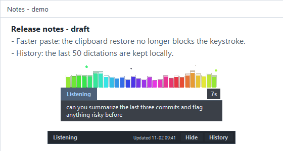
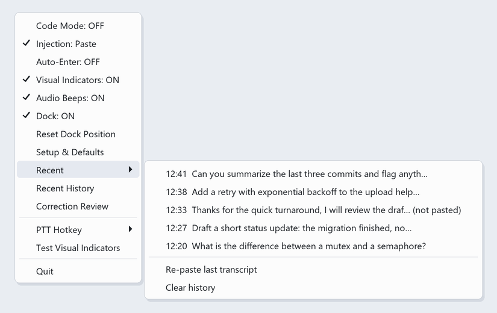
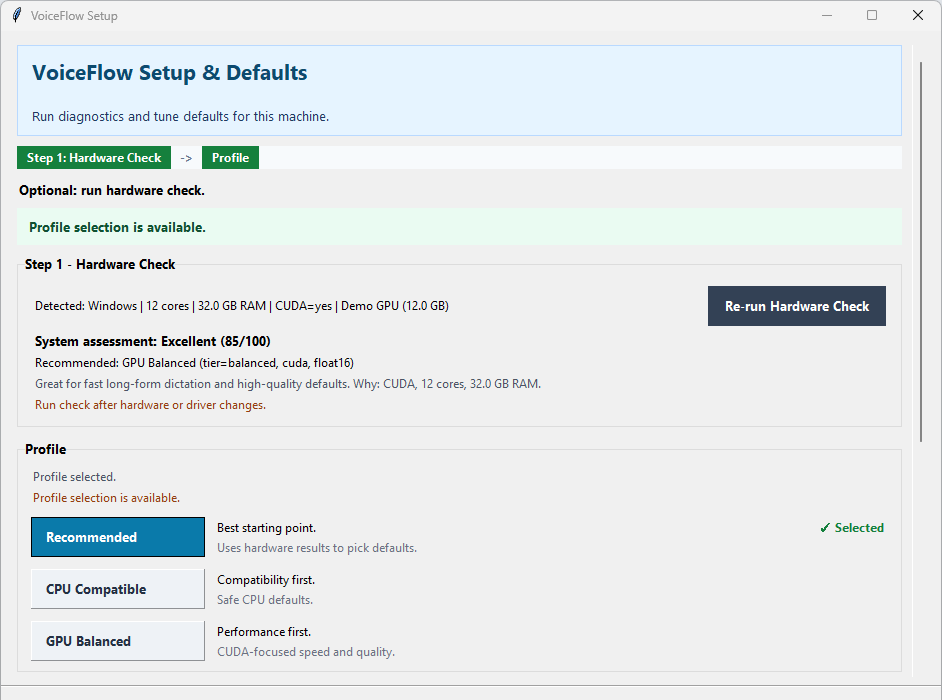

# VoiceFlow

**Free, local push-to-talk transcription for Windows — the open-source alternative to Wispr Flow.** Hold a hotkey, speak, release — the text is pasted into whatever window has focus. Transcription runs on your machine; audio never leaves it.

[](https://github.com/GrimFandango42/VoiceFlow/actions/workflows/ci.yml)
[](https://github.com/GrimFandango42/VoiceFlow/releases/latest)
[](https://github.com/GrimFandango42/VoiceFlow/releases/latest)
[](LICENSE)



| Tray menu: recent dictations, one click to copy | Setup & Defaults |
|---|---|
|  |  |

*These images are rendered by [`scripts/capture_screenshots.py`](scripts/capture_screenshots.py) in a demo mode (no microphone, no hotkeys, no paste, fixed demo text, never your desktop). More in the [User Guide](docs/USER_GUIDE.md).*

---

## Quick start

**Requirements:** Windows 10/11 (64-bit), 4 GB RAM (8 GB+ for GPU), a microphone. An NVIDIA GPU is optional; without one VoiceFlow runs on the CPU.

**Option A — packaged app (recommended).** Download `VoiceFlow-win64.exe` (or the portable zip) from the [latest release](https://github.com/GrimFandango42/VoiceFlow/releases/latest). Windows SmartScreen may warn about an unsigned app: **More info → Run anyway**. On first launch the setup wizard opens: **Run Hardware Check**, pick a profile, **Save and Launch**.

**Option B — from source.**

```bash
git clone https://github.com/GrimFandango42/VoiceFlow.git
cd VoiceFlow
python -m venv .venv
.venv\Scripts\activate
pip install -e ".[dev]"
python _app_entry.py            # run from the repo root, not from src/
```

For a GPU, create `.venv-gpu` instead (`scripts\setup\bootstrap_windows.ps1 -GpuVenv`), then install the NVIDIA runtime wheels (see the GPU note) and start with `.venv-gpu\Scripts\python.exe dev.py`: it runs the model in its own process and restarts only the app when you save a `.py` file. See [How to launch](docs/HOW_TO_LAUNCH.md).

> **GPU note.** The CUDA path needs cuBLAS 12 and cuDNN 9 (`cublas64_12.dll`, `cudnn_ops64_9.dll`). Install them directly with `pip install nvidia-cublas-cu12 nvidia-cudnn-cu12` (a few hundred MB; a CUDA build of PyTorch also works but is several GB and is not used for transcription). A CPU-only `torch` satisfies the install and then silently gives no GPU, and a CUDA 11.8 / cuDNN 8 stack is the wrong major version for ctranslate2 4.x. VoiceFlow also finds the DLLs in the active environment's `torch\lib`, in a folder named by `VOICEFLOW_TORCH_LIB_DIR`, or on `PATH`. Verify with `python -c "import ctranslate2; print(ctranslate2.get_cuda_device_count())"`: `0` means VoiceFlow will fall back to CPU `int8` (roughly 85x slower). The log line `asr_engine_initialized` shows the device actually in use (`device=cuda compute=float16`). The packaged build bundles these DLLs and refuses to build without them ([Build guide](docs/BUILD_GUIDE.md)).

**Dictate.** Focus any text field, hold **Ctrl+Shift**, speak, release. Everything else is optional:

| Key | Does |
|---|---|
| `Ctrl+Shift` (hold) | Record; release to transcribe and paste |
| `Esc` while recording | Throw the recording away |
| `Alt+Shift+V` | Re-paste the last transcript where your cursor is |
| `Ctrl+Alt+C` / `P` / `Enter` | Toggle code mode / paste-vs-type / auto-Enter |

`Ctrl+Shift` and `Alt+Shift+V` deliberately avoid `Ctrl+Alt`, which Wispr Flow and VoiceFlow's own toggles use, so VoiceFlow can run next to Wispr Flow. The push-to-talk key (tray → **PTT Hotkey**), the re-paste key and the cancel key can be changed, and the last two switched off. See the [User Guide](docs/USER_GUIDE.md).

---

## What it does

- **Local transcription** with [faster-whisper](https://github.com/SYSTRAN/faster-whisper). The default `quick` tier uses `small.en` on the CPU and `distil-large-v3` on a CUDA GPU. No API call is on the transcription path.
- **Live caption and overlay** — a compact waveform, the words so far, a status badge and a recording timer (`7s`, then `1:05`); the dock shows the state and the date of the build you are running.
- **Built for long dictation into AI chats** — long recordings are cut at your pauses and decoded piece by piece; silence and noise are gated by a real VAD; `um`/`uh`, stutters and false starts are cleaned conservatively; "new line", "new paragraph" and "bullet, …" work as spoken commands.
- **Nothing is lost** — the last 50 dictations are kept locally *before* the paste is attempted. If the target window closed, the text is in the tray's **Recent** list and on the clipboard.
- **Learns your words** — terms you correct twice join the Whisper hotwords; corrections also feed local replacement rules.
- **Tray-first** — settings, history and correction review live in the tray menu; no window sits open.
- **Self-check** — the packaged app can verify itself without touching the microphone: `VoiceFlow.exe --self-check=report.json` ([Build guide](docs/BUILD_GUIDE.md)).

## Privacy

Audio never leaves your machine, and nothing is uploaded by default. Transcript history, learned terms and logs live under `%LOCALAPPDATA%\VoiceFlow`. The one optional cloud step — a nightly sample of transcripts sent to Anthropic (or Gemini) for vocabulary suggestions — is **off by default** and described in full in the [Security & Privacy guide](docs/guides/SECURITY_AND_PRIVACY.md#optional-nightly-cloud-analysis-off-by-default).

---

## VoiceFlow vs. Wispr Flow

Wispr Flow is the product VoiceFlow was built to replace for my own use, so it is the honest point of comparison. It is a polished commercial app with a real free tier, and it is better than VoiceFlow at several things — pick accordingly.

| | VoiceFlow | Wispr Flow |
|---|---|---|
| Price | Free, MIT licensed | Free tier with a weekly word cap; Pro [$15/mo, $12 annual](https://wisprflow.ai/pricing) |
| Processing | On-device | Cloud |
| Audio leaves your machine | No | Yes |
| GPU acceleration | Yes, CUDA | Not applicable |
| Platforms | Windows | Windows, macOS, iOS, Android |
| Modifiable | Yes, it's source | No |
| Setup | Clone or run an unsigned EXE; CUDA libraries for GPU | Install and sign in |
| Polish and support | A personal project | Funded product with a support team |

**Choose Wispr Flow** if you want something that works in two minutes, you're on a Mac or phone, or you'd rather not maintain anything. **Choose VoiceFlow** if your audio must stay on your machine, you want no usage cap, or you want to change how it behaves.

---

## Documentation

- [User Guide](docs/USER_GUIDE.md) — day-to-day use, hotkeys, history, formatting, vocabulary
- [FAQ](docs/guides/FAQ.md) and [How to launch](docs/HOW_TO_LAUNCH.md)
- [Build guide](docs/BUILD_GUIDE.md) — packaging, CUDA bundle, self-check
- [Architecture](docs/ARCHITECTURE.md) · [Latency budget](docs/LATENCY_BUDGET.md) · [Testing](docs/TESTING_NOTES.md)
- [Security & Privacy](docs/guides/SECURITY_AND_PRIVACY.md) · [Forking / other platforms](docs/guides/FORKING_AND_PLATFORM_GUIDE.md)
- [Changelog](CHANGELOG.md) · [Roadmap](ROADMAP.md) · [Contributing](CONTRIBUTING.md)

macOS and Linux are not supported; the [forking guide](docs/guides/FORKING_AND_PLATFORM_GUIDE.md) lists the seams a port would replace.

## License

MIT — see [LICENSE](LICENSE).
