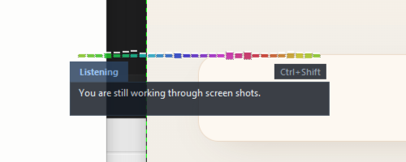
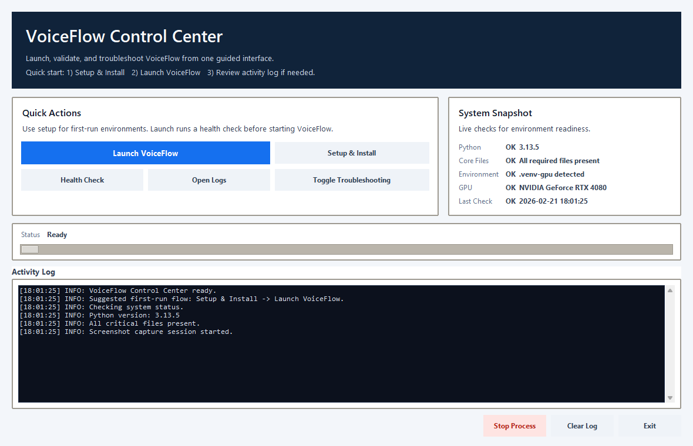

# VoiceFlow

**Free, local push-to-talk transcription for Windows — the open-source alternative to Wispr Flow.** Hold a hotkey, speak, release — transcribed text is injected directly into any active application. No cloud, no subscription, no audio ever leaving your machine.

[](https://github.com/GrimFandango42/VoiceFlow/actions/workflows/ci.yml)
[](https://github.com/GrimFandango42/VoiceFlow/releases/latest)
[](https://github.com/GrimFandango42/VoiceFlow/releases/latest)
[](LICENSE)



---

## Screenshots

VoiceFlow runs quietly in the system tray and surfaces a minimal overlay only while you're recording.

### Recording overlay

While you hold `Ctrl+Shift`, a compact overlay appears at the bottom of your screen with a reactive waveform and a live streaming preview of the transcription. Release the hotkey and the finalized text is injected into whatever window has focus.


### Control Center

A guided launcher for setup, health checks and troubleshooting:



---

## VoiceFlow vs. Wispr Flow

Wispr Flow is the product VoiceFlow was built to replace for my own use, so it is the
honest point of comparison. It is a polished commercial app with a real free tier, and
it is better than VoiceFlow at several things — pick accordingly.

| | VoiceFlow | Wispr Flow |
|---|---|---|
| Price | Free, MIT licensed | Free tier with a weekly word cap; Pro [$15/mo, $12 annual](https://wisprflow.ai/pricing) |
| Processing | On-device | Cloud |
| Audio leaves your machine | No | Yes |
| GPU acceleration | Yes, CUDA | Not applicable |
| Platforms | Windows | Windows, macOS, iOS, Android |
| Modifiable | Yes, it's source | No |
| Setup | Clone or run an unsigned EXE; CUDA libraries for GPU | Install and sign in |
| Polish and support | A personal project | Funded product with a support team |

**Choose Wispr Flow** if you want something that works in two minutes, you're on a Mac
or phone, or you'd rather not maintain anything.

**Choose VoiceFlow** if your audio must stay on your machine, you want no usage cap, or
you want to change how it behaves.


---

## What is VoiceFlow?

VoiceFlow runs entirely on your machine using [faster-whisper](https://github.com/SYSTRAN/faster-whisper) (Distil-Whisper Large v3.5 by default). There is no API call on the transcription path — audio goes in, text comes out locally, and is injected into whatever window you have focused.

It ships with a continual-learning system that adapts to your accent and vocabulary over time, a streaming preview that shows partial transcription while you speak, and a tray-first UI that stays out of the way when you're not using it.

---

## Quick Start

### Requirements

- Windows 10 or 11 (64-bit)
- 4 GB RAM minimum; 8 GB+ recommended for GPU mode
- NVIDIA GPU for acceleration (optional but recommended) — needs cuBLAS 12 and cuDNN 9;
  see the GPU note under **Install**. Without them VoiceFlow runs on CPU.

### Install

**Option A — Packaged EXE (recommended)**

1. Download `VoiceFlow-win64.exe` from the [latest release](https://github.com/GrimFandango42/VoiceFlow/releases/latest).
2. Run it. Windows may show a SmartScreen warning — click **More info → Run anyway**.
3. On first launch the setup wizard opens. Click **Run Hardware Check**, choose a profile, and click **Save and Launch**.

**Option B — From source**

```bash
git clone https://github.com/GrimFandango42/VoiceFlow.git
cd VoiceFlow
python -m venv .venv
.venv\Scripts\activate
pip install -e ".[dev]"
# Run from the repo root (not from src/)
python _app_entry.py
```

> **GPU users:** transcription runs through ctranslate2, which needs cuBLAS 12 and
> cuDNN 9 on the DLL search path. Install them directly — they are a few hundred
> megabytes, where a CUDA build of PyTorch is several gigabytes and is not used on
> the transcription path at all:
>
> ```bash
> pip install nvidia-cublas-cu12 nvidia-cudnn-cu12
> ```
>
> Do not rely on a CUDA build of PyTorch to supply these. A CPU-only `torch` satisfies
> the install and then silently gives you no GPU, and a cuDNN 8 / CUDA 11.8 stack is the
> wrong major version for ctranslate2 4.x. Verify with:
>
> ```bash
> python -c "import ctranslate2; print(ctranslate2.get_cuda_device_count())"
> ```
>
> A `0` means the libraries were not found and VoiceFlow will fall back to CPU `int8`,
> which is roughly 85x slower. On startup the log line `asr_engine_initialized` records
> the device actually in use — check it says `device=cuda compute=float16`.

### First use

1. The setup wizard opens on first launch. Run the hardware check to auto-select CPU or GPU mode.
2. Click **Save and Launch**.
3. Focus any text field (Notepad, VS Code, a browser input, anything).
4. Hold **Ctrl+Shift**, speak, then release.
5. Transcribed text appears at your cursor.

---

## Features

- **Hold-to-record** with configurable hotkey (`Ctrl+Shift` default)
- **Local inference** — faster-whisper, no internet required after model download
- **GPU acceleration** — CUDA path for NVIDIA GPUs; automatic CPU fallback
- **Streaming preview** — partial transcription visible while speaking, with filler words (uh/um/er) stripped in real time and safe cleanup applied so the preview reads like final output; per-sentence continuity rather than a rolling word window
- **Reactive waveform animation** — spring physics with per-bar stiffness and damping, burst energy injected on speech onset, and sympathetic vibration between neighboring bars
- **Continual learning** — adapts to your accent and domain vocabulary over time
- **Text injection** — pastes directly into the active application
- **Tray-first UI** — stays out of the way; right-click tray for settings
- **Three cleanup passes** — light typo fix (on), safe second pass (on), heavy rewrite (opt-in)
- **History & correction** — review recent transcriptions, submit corrections from tray
- **Cold-start elimination** — model pre-warmed before first keypress
- **24/7 stability** — command queue cap, idle-aware monitoring, and overlay focus hardening prevent drift during long sessions

---

## Architecture Overview

```
voiceflow/
├── core/
│   ├── asr_engine.py        # faster-whisper inference, model tier selection
│   ├── audio_enhanced.py    # sounddevice capture, VAD, chunking
│   ├── streaming.py         # streaming partial results
│   ├── textproc.py          # cleanup passes, destination-aware formatting
│   ├── preloader.py         # background model pre-warming
│   └── config.py            # typed config dataclass
├── ui/
│   ├── cli_enhanced.py      # main entry point, hotkey listener, orchestration
│   ├── visual_indicators.py # overlay + dock UI (tkinter)
│   ├── tray.py              # system tray (pystray)
│   └── setup_wizard.py      # first-run wizard (tkinter)
├── ai/
│   ├── adaptive_memory.py   # continual learning, pattern extraction
│   ├── daily_learning.py    # nightly batch learning pass
│   └── course_corrector.py  # real-time correction pipeline
├── models/
│   └── tray_state.py        # shared state types between tray and orchestrator
└── platform/
    └── factory.py           # platform injection abstraction (Windows: pywin32)
```

The hotkey listener captures audio into a ring buffer, passes it through VAD, then calls the ASR engine. Text flows through the cleanup pipeline and is injected via the platform layer. The UI receives status updates over a thread-safe command queue.

---

## Platform Support

| Platform | Status |
|----------|--------|
| Windows 10/11 | Fully supported |
| macOS | Community fork — see [FORKING_AND_PLATFORM_GUIDE.md](docs/guides/FORKING_AND_PLATFORM_GUIDE.md) |
| Linux | Community fork — see [FORKING_AND_PLATFORM_GUIDE.md](docs/guides/FORKING_AND_PLATFORM_GUIDE.md) |

---

## Configuration

Most settings are available through the setup wizard (right-click tray → **Setup & Defaults**). Config is stored at `%LOCALAPPDATA%\VoiceFlow\config.json`.

Key settings:

| Setting | Default | Description |
|---------|---------|-------------|
| `device` | auto | `cuda` or `cpu` |
| `model_tier` | `quick` | `tiny`, `quick`, `balanced`, `quality` |
| `enable_light_typo_correction` | `true` | Light cleanup pass |
| `enable_safe_second_pass_cleanup` | `true` | Second cleanup pass |
| `enable_heavy_second_pass_cleanup` | `false` | Aggressive rewrite (opt-in) |
| `press_enter_after_paste` | `false` | Auto-submit after paste |
| `adaptive_ai_analysis_enabled` | `false` | Nightly cloud analysis of transcript samples (opt-in; see Continual Learning) |

---

## Continual Learning

VoiceFlow observes the delta between raw transcripts and final text. Recurring corrections are promoted into adaptive replacement rules.

- Rules are stored locally in `%LOCALAPPDATA%\VoiceFlow\adaptive_patterns.json`
- Daily learning runs a nightly batch pass; reports land in `%LOCALAPPDATA%\VoiceFlow\daily_learning_reports\`
- **What leaves your machine:** by default, nothing. The nightly pass has an optional cloud step — **Setup & Defaults → "Send a daily sample of transcripts to Claude"**, off by default — that, for the target date, sends to Anthropic via the Claude CLI (or Google Gemini if the CLI is missing): your transcripts, verbatim — up to 8 by default (configurable); the same number of your original/corrected correction pairs; the top word replacement pairs; recurring instruction themes; and a snapshot of the learned adjustment rules. This is used to suggest vocabulary and phrasing rules. Audio is never sent. If a managed (enterprise) Claude Code policy is present — a managed-settings file that declares hooks (including `managed-settings.d` fragments), or on Windows the `SOFTWARE\Policies\ClaudeCode` registry key under `HKLM` or `HKCU` — the Claude CLI step is skipped rather than run, because `--safe-mode` cannot be trusted to suppress managed hooks. On an organization-managed Claude account, server-delivered policy hooks could observe this prompt; this feature is intended for personal accounts. Each nightly report records `ai_learning_analysis.enabled` so you can confirm what happened.
- Explicit corrections via the History panel rank higher than auto-inferred rules
- Add personal terminology in `%LOCALAPPDATA%\VoiceFlow\engineering_terms.json`

---

## Contributing

1. Fork the repo and create a feature branch from `main`.
2. Set up the dev environment:
   ```bash
   pip install -e ".[dev]"
   ```
3. Run the test suite before and after your changes:
   ```bash
   pytest tests/ -x -q
   ```
4. Keep UI changes in `visual_indicators.py`; keep ASR changes in `core/`. Do not mix layers.
5. Test with the packaged bundle (`dist\VoiceFlow\VoiceFlow.exe`) for end-to-end validation.
6. Open a pull request against `main` with a description of what changed and why.

See [CONTRIBUTING.md](CONTRIBUTING.md) for the full guide.

---

## License

MIT — see [LICENSE](LICENSE).
