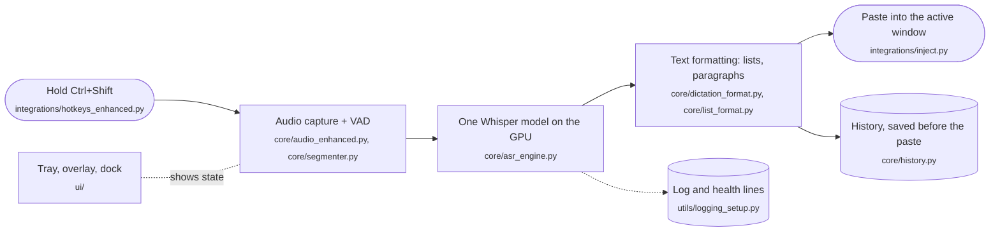
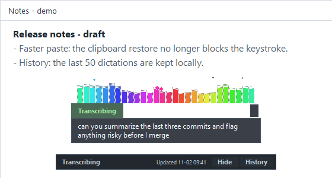
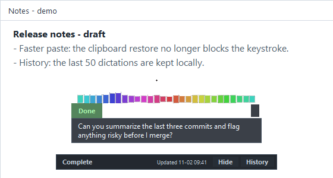
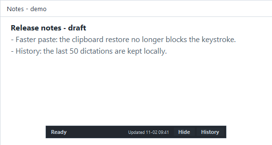

<p align="center">
  
</p>

**Hold a key, speak, let go: your words are typed into whatever window you are in.** VoiceFlow is free, local push-to-talk dictation for Windows, an open-source alternative to Wispr Flow. Transcription runs on your machine, and your audio never leaves it.

[](https://github.com/GrimFandango42/VoiceFlow/actions/workflows/ci.yml)
[](https://github.com/GrimFandango42/VoiceFlow/releases/latest)
[](pyproject.toml)
[](https://github.com/GrimFandango42/VoiceFlow/releases/latest)
[](LICENSE)


*Every image here is rendered by [`scripts/capture_screenshots.py`](scripts/capture_screenshots.py) in demo mode: no microphone, no hotkeys, no paste, fixed demo text, never a real desktop.*

---

## Why it exists

Talking is faster than typing, especially when you are writing long prompts to an AI assistant. The polished dictation apps send your voice to the cloud and charge a monthly fee or cap your words. VoiceFlow does the same job with an open speech model ([Whisper](https://github.com/SYSTRAN/faster-whisper)) running on your own PC, with no account, no cap and nothing uploaded by default.

---

## Quickstart

**You need:** Windows 10 or 11 (64-bit), 4 GB RAM (8 GB or more for a GPU), and a microphone. An NVIDIA GPU is optional; without one VoiceFlow runs on the CPU. No API key is needed.

### Option A: the packaged app (recommended)

1. Download `VoiceFlow-win64.exe` (or `VoiceFlow-portable-win64.zip`) from the [latest release](https://github.com/GrimFandango42/VoiceFlow/releases/latest).
2. Windows SmartScreen may warn that the app is unsigned: click **More info → Run anyway**.
3. The setup wizard opens on first launch: **Run Hardware Check**, pick a profile, then **Save and Launch**.

### Option B: from source

```powershell
git clone https://github.com/GrimFandango42/VoiceFlow.git
cd VoiceFlow
python -m venv .venv
.venv\Scripts\activate
pip install -e ".[dev]"
python _app_entry.py            # run from the repo root, not from src/
```

Always start from source with `_app_entry.py` or `dev.py`, never `python -m voiceflow.ui.cli_enhanced` (see [Troubleshooting](#troubleshooting)).

<details>
<summary><b>From source with an NVIDIA GPU (hot reload)</b></summary>

```powershell
powershell -ExecutionPolicy Bypass -File scripts\setup\bootstrap_windows.ps1 -GpuVenv   # creates .venv-gpu
# then install a CUDA 12 build of PyTorch into .venv-gpu (it supplies the CUDA DLLs; see the GPU note)
.venv-gpu\Scripts\python.exe dev.py
```

`dev.py` loads the model once in its own process and restarts only the app when you save a `.py` file. See [How to launch](docs/HOW_TO_LAUNCH.md).

**GPU note.** The CUDA path needs cuBLAS 12 and cuDNN 9 (`cublas64_12.dll`, `cudnn_ops64_9.dll`). When run from source, VoiceFlow looks for them in the environment's `torch\lib` (a [CUDA 12 build of PyTorch](https://pytorch.org/get-started/locally/) puts them there; it is several GB, and PyTorch itself is not used for transcription), in one folder named by `VOICEFLOW_TORCH_LIB_DIR`, or on `PATH`. The smaller `nvidia-cublas-cu12` / `nvidia-cudnn-cu12` wheels also contain them, but in their own `bin` folders: the build script finds those, a source run only does if both folders are on `PATH`. A CPU-only `torch` satisfies the install and then silently gives no GPU, and a CUDA 11.8 / cuDNN 8 stack is the wrong major version for ctranslate2 4.x. Check with:

```powershell
python -c "import ctranslate2; print(ctranslate2.get_cuda_device_count())"
```

`0` means VoiceFlow will fall back to CPU `int8` (roughly 85x slower). The log line `asr_engine_initialized` shows the device actually in use (`device=cuda compute=float16`). The packaged build bundles these DLLs and refuses to build without them ([Build guide](docs/BUILD_GUIDE.md)).

</details>

### Dictate

Click into any text field, hold **Ctrl+Shift**, speak, and let go.

| Key | What it does |
|---|---|
| `Ctrl+Shift` (hold) | Record; release to transcribe and paste |
| `Esc` while recording | Throw the recording away |
| `Alt+Shift+V` | Paste the last transcript again where your cursor is |
| `Ctrl+Alt+C` / `P` / `Enter` | Toggle code mode / paste-vs-type / auto-Enter |
| `Ctrl+Alt+R` | Replace the last paste with the reconstruction pass's result (only when that opt-in pass is on) |

`Ctrl+Shift` and `Alt+Shift+V` deliberately avoid `Ctrl+Alt`, which Wispr Flow and VoiceFlow's own toggles use, so the two apps can run side by side. You can change the push-to-talk key (tray → **PTT Hotkey**), the re-paste key and the cancel key, and switch the last two off. See the [User Guide](docs/USER_GUIDE.md).

---

## How it works



1. **Hold the key.** One microphone stream fills a buffer and a live caption appears on the overlay.
2. **Let go.** Recordings of 20 seconds or more are cut at your pauses and decoded piece by piece; silence and noise are gated by Silero VAD (a small voice-activity model) so Whisper never hears them.
3. **Decode.** One faster-whisper model does the work. The default `quick` tier uses `distil-large-v3` on a CUDA GPU and `small.en` on the CPU. If CUDA fails, VoiceFlow says so (tray, balloon, overlay), falls back to CPU `int8` and retries the GPU about every two minutes while idle.
4. **Format.** Spoken lists become real lists, long dictations break into paragraphs at pauses, `um`/`uh` and false starts are cleaned conservatively.
5. **Save, then paste.** The transcript goes into local history *before* the paste, into the window that had focus when you released the key.

The full data flow, configuration and environment variables are in [Architecture](docs/ARCHITECTURE.md); where the time goes is in the [Latency budget](docs/LATENCY_BUDGET.md).

---

## What you can do

| | |
|---|---|
| **See what it is doing.** A waveform, the words so far, a status badge and a timer (`7s`, then `1:05`). The dock shows the state and the date of the build you run. |  |
| **Never lose a dictation.** The last 50 are kept locally before the paste is tried. If the window closed, the text is in tray → **Recent** (click to copy) and on the clipboard; entries that did not paste are marked. |  |
| **Set it up once.** The setup wizard checks your hardware and recommends a CPU or GPU profile. Reopen it from tray → **Setup & Defaults**. |  |
| **Dictate long text into AI chats.** Long recordings are decoded pause by pause; "new line", "new paragraph" and "bullet, …" work as spoken commands; "first… second…" becomes a list. |  |

<details>
<summary><b>More: learning, self-check, privacy</b></summary>

- **Learns your words.** Terms you correct twice in **Correction Review** become Whisper hotwords; corrections also feed local replacement rules. Explicit corrections count more than automatic analysis.
- **Tray-first.** Settings, history and correction review live in the tray menu; no window sits open. The dock can be hidden.
  
- **Self-check.** The packaged app can check itself without touching the microphone, tray or hotkeys: `VoiceFlow.exe --self-check=report.json` ([Build guide](docs/BUILD_GUIDE.md)).
- **Privacy.** Audio never leaves your machine and nothing is uploaded by default. Transcript history, learned terms, logs, a local tuning log and the newest 30 dictation recordings (`keep_audio_last_n`; `0` keeps none) live under `%LOCALAPPDATA%\VoiceFlow`. The one optional cloud step, a nightly sample of transcripts sent to Anthropic (or Gemini) for vocabulary suggestions, is **off by default** and described in full in the [Security & Privacy guide](docs/guides/SECURITY_AND_PRIVACY.md#optional-nightly-cloud-analysis-off-by-default).

</details>

### VoiceFlow vs. Wispr Flow

Wispr Flow is the product VoiceFlow was built to replace for one person's own use, so it is the honest point of comparison. It is a polished commercial app with a real free tier, and it is better than VoiceFlow at several things. Pick accordingly.

| | VoiceFlow | Wispr Flow |
|---|---|---|
| Price | Free, MIT licensed | Free tier with a weekly word cap; Pro [$15/mo, $12 annual](https://wisprflow.ai/pricing) |
| Processing | On-device | Cloud |
| Audio leaves your machine | No | Yes |
| GPU acceleration | Yes, CUDA | Not applicable |
| Platforms | Windows | Windows, macOS, iOS, Android |
| Modifiable | Yes, it's source | No |
| Setup | Clone or run an unsigned EXE; CUDA libraries for GPU | Install and sign in |
| Polish and support | A personal project | Funded product with a support team |

**Choose Wispr Flow** if you want something that works in two minutes, you're on a Mac or phone, or you'd rather not maintain anything. **Choose VoiceFlow** if your audio must stay on your machine, you want no usage cap, or you want to change how it behaves.

---

## Project layout

| Folder | What is in it |
|---|---|
| [`src/voiceflow/`](src/voiceflow/) | The app: `core/` (audio, Whisper engine, segmenter, formatting, history), `integrations/` (hotkeys, paste), `ui/` (tray, overlay, dock, setup wizard), `ai/` (local learning), `utils/` (config, logging, build identity) |
| [`tests/`](tests/) | The pytest suite, in `tests/runtime/` |
| [`scripts/`](scripts/) | `setup/` (bootstrap, build, bundle check), `dev/` (smoke test, latency log analysis), screenshot and docs checkers |
| [`docs/`](docs/) | User guide, architecture, build and launch guides, screenshots ([index](docs/README.md)) |
| [`packaging/windows/`](packaging/windows/) | Installer script and winget manifest template |
| [`wiki/`](wiki/) | Decisions, known issues and the project log |
| `.github/` | CI, release build and issue templates |

Root launchers (`VoiceFlow.bat`, `VoiceFlow_Quick.bat`, `VoiceFlow_Silent.bat`, `VoiceFlow_Tray.vbs`, …) are for source debugging; they end stale VoiceFlow processes first. See [How to launch](docs/HOW_TO_LAUNCH.md).

---

## Troubleshooting

| Symptom | Cause | Fix |
|---|---|---|
| The text was not pasted | Focus moved (a popup or notification) or the target window closed when you released the key | Nothing is lost: click back in and press `Alt+Shift+V`, or tray → **Recent**. The log shows `inject_focus_drift`. |
| It works but is slow; the log says `device=cpu compute=int8` | The CUDA 12 / cuDNN 9 DLLs were not found (often a CPU-only `torch`); the log also has `cuda_runtime_unavailable missing_dlls=...` | Install the runtime as in the GPU note above and check `ctranslate2.get_cuda_device_count()` is not `0`. The packaged app bundles the DLLs. |
| VoiceFlow will not start, or closes itself at once | A leftover VoiceFlow process holds the single-instance guard, or it was started with `python -m voiceflow.ui.cli_enhanced` | End the old process (Task Manager or `scripts\setup\stop_voiceflow_processes.ps1`) and start with `_app_entry.py`, `dev.py` or the EXE. |
| It presses Enter after every dictation | Auto-Enter is on | Tray → **Auto-Enter**, or `Ctrl+Alt+Enter`. |
| Windows warns before the EXE runs | The release is not code-signed | **More info → Run anyway**. |

More answers in the [FAQ](docs/guides/FAQ.md). The runtime log is `%LOCALAPPDATA%\VoiceFlow\logs\voiceflow.log`; if it is locked, `logs\active_log_path.txt` names the live file.

---

## Contributing

```powershell
pip install -e ".[dev]"
pytest tests/ -m "not audio and not gui and not slow"   # what CI runs
ruff check src/                                          # the CI lint gate
python scripts/check_docs.py                             # every link and image path resolves
```

The test suite points `%LOCALAPPDATA%` at a temporary folder, so it never touches your real VoiceFlow data. For end-to-end checks, build the bundle (`scripts\setup\build_windows_exe.ps1`, see the [Build guide](docs/BUILD_GUIDE.md)) and test `dist\VoiceFlow\VoiceFlow.exe` rather than the batch launchers.

Start with [CONTRIBUTING.md](CONTRIBUTING.md). Decisions are recorded in [`wiki/decisions.md`](wiki/decisions.md) and the [Changelog](CHANGELOG.md); plans are in the [Roadmap](ROADMAP.md). macOS and Linux are not supported; the [forking guide](docs/guides/FORKING_AND_PLATFORM_GUIDE.md) lists the parts a port would replace.

---

MIT licensed, see [LICENSE](LICENSE). Maintained with the relay (Claude, Codex, Gemini).
