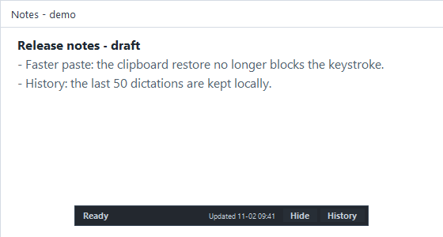
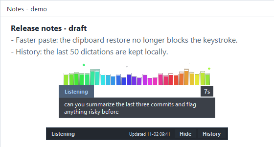
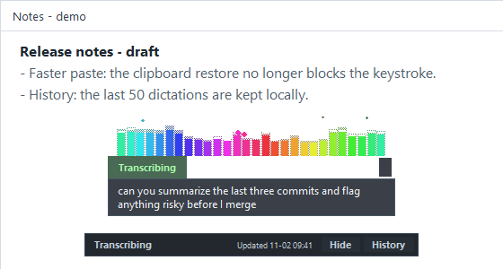
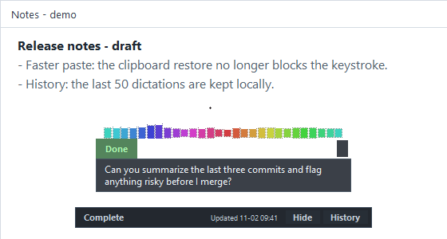
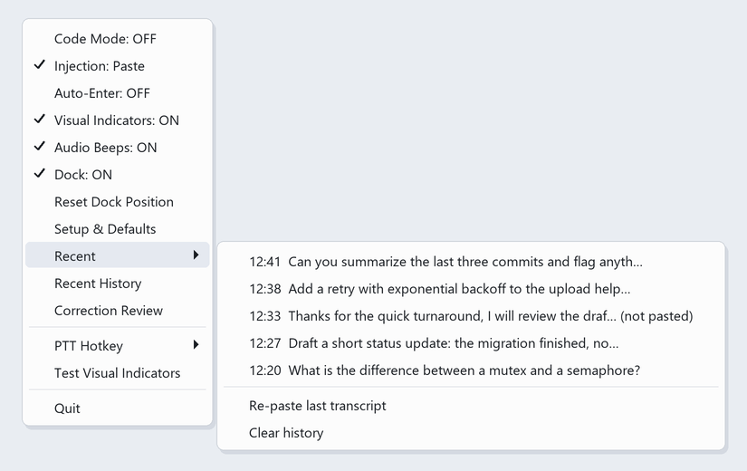
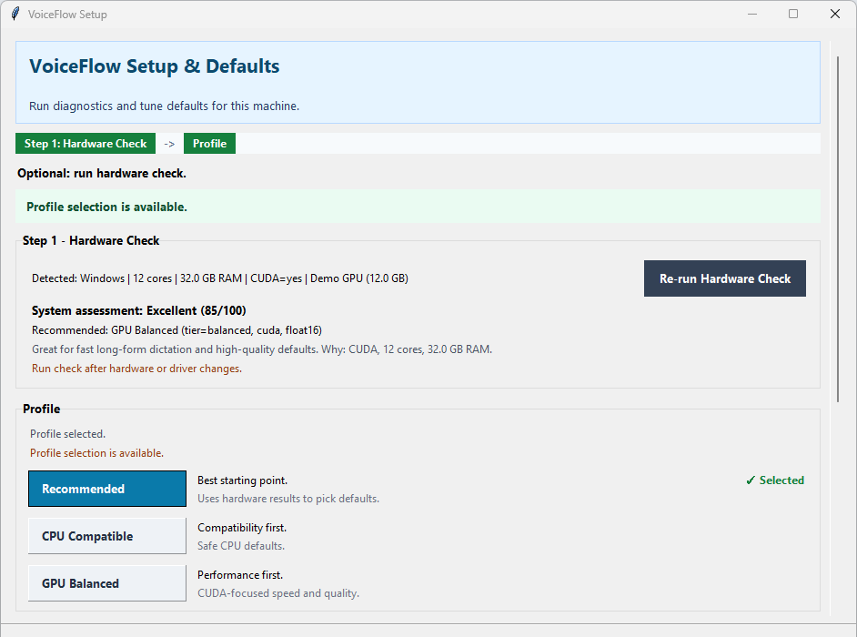

# VoiceFlow User Guide

## Core workflow

1. Focus the app you want to type into.
2. Hold push-to-talk (`Ctrl+Shift` by default) and speak.
3. Release. VoiceFlow transcribes, cleans the text and pastes it. It does not press Enter unless you turn **Auto-Enter** on.

Keys at a glance:

| Key | Does | Configurable |
|---|---|---|
| `Ctrl+Shift` (hold) | Record; release to transcribe and paste | Tray → **PTT Hotkey** (presets) |
| `Esc` while recording | Discard the recording; nothing is transcribed | `cancel_recording_key` (empty disables) |
| `Alt+Shift+V` | Re-paste the last transcript into the focused window | `repaste_hotkey` (empty disables) |
| `Ctrl+Alt+C` | Toggle code mode | fixed |
| `Ctrl+Alt+P` | Toggle paste / type injection | fixed |
| `Ctrl+Alt+Enter` | Toggle auto-Enter after paste | fixed |
| `Ctrl+Alt+R` | Replace the last paste with the improved version (only when the optional reconstruction pass is on and has one ready) | `replace_last_paste_hotkey` |

The re-paste and cancel keys avoid `Ctrl+Shift` (the push-to-talk hold) and `Ctrl+Alt` (the toggles above, and Wispr Flow), so VoiceFlow can run beside Wispr Flow. `Esc` is only watched while a recording is in progress, and `Ctrl+Shift+Esc` still opens Task Manager.

## What you see

VoiceFlow is tray-first: the tray icon, a small **dock** and a transient **overlay**. There is no main window.

The overlay appears while you record, with a waveform, a status badge and the live caption (the words so far). The **timer** on the right counts the recording (`7s`, then `1:05` after a minute). The badge reads **Listening**, then **Processing** / **Transcribing**, then **Done** (or **Error**), and the finished text stays in the caption for about two seconds.

| Idle (dock only) | Recording, 7 s in |
|---|---|
|  |  |

| Transcribing | Done — the pasted text |
|---|---|
|  |  |

The **dock** (always visible unless you hide it) shows the state — Ready, Listening, … — and **Updated MM-DD HH:MM**, the date the running build was made, so you can tell at a glance whether you are on the build you just made. **History** opens the recent-transcripts panel and **Hide** hides the dock; you can drag the dock and the history panel anywhere (positions are remembered; tray → **Reset Dock Position** puts them back).

These screenshots are generated in a demo mode — see [Screenshots](#screenshots).

## Tray menu

Right-click the tray icon.



| Goal | Menu item | Saved as |
|---|---|---|
| Open the setup window | **Setup & Defaults** | setup fields and chosen defaults |
| Code mode (code-friendly term mapping) | **Code Mode** | session toggle |
| Paste vs. type the text | **Injection** | `paste_injection` |
| Press Enter after pasting (default off) | **Auto-Enter** | `press_enter_after_paste` |
| Show / hide the overlay | **Visual Indicators** | `visual_indicators_enabled` |
| Start / stop beeps | **Audio Beeps** | `audio_feedback_beeps` |
| Show / hide the dock | **Dock** | `visual_dock_enabled` |
| Put dock, history and overlay back at the default spot | **Reset Dock Position** | — |
| Re-use a recent dictation | **Recent** (see below) | — |
| Browse recent dictations / correct them | **Recent History**, **Correction Review** | — |
| Change the push-to-talk key | **PTT Hotkey** → preset | `hotkey_*` |
| Play the overlay through its states | **Test Visual Indicators** | — |

## History and re-paste

Every final transcript is written to a local list **before** VoiceFlow tries to paste it, so a paste that misses never loses text.

- **Tray → Recent** lists the newest 10 dictations (time and first words); click one to copy it. Older ones (up to 50 are kept) are under **Older (11-20)**, **Older (21-30)** and so on. An entry marked **(not pasted)** was recognised but the paste did not land. A dictation that produced nothing usable (silence, noise, a result discarded as a likely silence artifact, too short, a timeout or an error) is listed too, tagged `[failed]`, `[discarded]` or `[too short]`, and the history panel has a **Failed** filter for them. Copying such an entry returns any text that was recognised before it was dropped. Holds under one second that yield nothing are only logged.
- **Re-paste last transcript** (or `Alt+Shift+V`) pastes the last one where your cursor is now.
- **Clear history** deletes the list. It is a local file, `%LOCALAPPDATA%\VoiceFlow\transcript_history.json`, and is never uploaded.

**Where the text goes.** By default into the window that has focus at the moment you let go of the hotkey (`inject_target_policy = release`), so you can start talking and switch windows before releasing. Set it to `start` to always paste into the window you were in when you pressed the key. If that window has closed, nothing is pasted anywhere: the text goes to history and the clipboard.

If the paste can't land because focus moved, the transcript is copied to the clipboard and kept in history. (The overlay badge shows **Done** or **Error**; the exact reason is in the log and the history entry, not on the overlay.)

## Dictating to AI assistants and long text

- **Long recordings are decoded pause by pause.** A recording of 20 s or more is cut at your own pauses and each piece is decoded separately, so silence never reaches the model (no phantom "Thank you." after a long think). Pauses of 2.5 s or more become paragraph breaks. Turn off with `segmented_transcription_enabled`.
- **Noise and silence are gated by a real voice detector** (Silero VAD, bundled, offline). A long recording with no speech in it is not decoded at all, and a piece with no speech in it is skipped. Turn off with `silence_vad_gate_enabled`.
- **Say structure out loud.** "new line", "new paragraph" and "bullet, …" work when said as their own phrase (pause around them): "Bullet, buy milk." becomes `- Buy milk.` Inside a sentence they stay literal ("a new line of products", "bullet train").
- **Long dictations get paragraphs and lists.** A dictation of 60 or more words with no line breaks is split into paragraphs where the subject changes ("So yeah", "Also", "The other thing", …) or after five sentences; words are never changed. Terminals, code mode and typed injection keep one block. Spoken lists ("point one …", "first … second …") become list lines. Recordings of 20 s or more also break where you paused for 2.5 s or more (never for a dictation under three sentences). Holding the key and saying nothing pastes nothing and shows up in Recent as "No speech was detected". Turn paragraphs off with `auto_paragraphs_enabled`, lists with `auto_lists_enabled`.
- **Optional reconstruction pass (off by default).** `reconstruction_enabled` runs a local Ollama model (CPU only) on each dictation (it pastes first and only waits when it has proven fast) to repair form — casing, punctuation, run-ons, mis-heard vocabulary terms — never meaning. Numbers, names and paths must survive verbatim or the original is kept. An accepted result appears as the tray entry **Replace last paste with improved version** (or `Ctrl+Alt+R`); it is refused unless the same window is still focused and nothing was typed since. See [Faithful dictation](FAITHFUL_DICTATION.md).
- **Ums and false starts** (`um`, `uh`, "the, the thing", "I think I think", a sentence-opening "I mean,") are removed conservatively; real repeats ("that that", "very very") stay. "Send it to John, no wait, send it to Jane" becomes "Send it to Jane". Say "scratch that" as its own phrase to drop the sentence before it. File names, paths, CamelCase and flags are never edited.
- **Chat windows keep your line breaks** when pasting (`chat_preserve_newlines`, default on), since a paste does not press Enter. Typed injection strips them.

## Vocabulary and learning

VoiceFlow adapts to your words, locally:

- **Hotwords.** `asr_hotwords` (a short seed list of product names) is passed to Whisper on every decode. Edit it to your own terms.
- **Corrections stick.** A term you correct twice in **Correction Review** (`learned_hotword_min_count`) is stored in `learned_hotwords.json` and added to the hotwords (up to `learned_hotwords_max`, default 24; `learned_hotwords_enabled`). Local only; independent of the cloud setting below.
- **Your vocabulary file.** `%LOCALAPPDATA%\VoiceFlow\custom_vocabulary.txt` is seeded once from a bundled default and never overwritten. Each `wrong phrase -> correct phrase` line rewrites the text after transcription, and the right-hand sides also bias Whisper (`initial_prompt`). Edit it freely; add your own corrections at the end.
- **Terms file.** House-style terms can also go in `%LOCALAPPDATA%\VoiceFlow\engineering_terms.json` (examples in [`docs/examples/`](examples/)).
- **Replacement rules.** Recurring corrections become local replacement rules (`adaptive_patterns.json`). Explicit corrections rank above auto-inferred ones, and a saved correction affects the next dictation in the same session.
- **Nightly learning** replays the day's corrections and writes a report to `%LOCALAPPDATA%\VoiceFlow\daily_learning_reports\`. Run it by hand with `.\VoiceFlow_DailyLearning.bat` (`--dry-run` to preview) or schedule it:

  ```powershell
  powershell -ExecutionPolicy Bypass -File .\scripts\setup\register_daily_learning_task.ps1 -StartTime "08:00" -Force
  ```

- **Cloud step: off by default.** The nightly pass can send a sample of transcripts to Anthropic for vocabulary suggestions. It does nothing unless you tick **Setup & Defaults → "Send a daily sample of transcripts to Claude"**. What is sent, and how to verify it, is in [Security & Privacy](guides/SECURITY_AND_PRIVACY.md#optional-nightly-cloud-analysis-off-by-default).

To improve accuracy fastest: open **Correction Review**, fix recurring misses, and let the nightly pass process them.

## Setup & Defaults

The setup window opens automatically on first launch and any time from tray → **Setup & Defaults**.



- First launch: **Step 1: Run Hardware Check (Required)**. Step 2 stays locked until the check completes.
- Choose a profile: **Recommended** (picked from the hardware check), **CPU Compatible** (safest) or **GPU Balanced** (CUDA).
- The cloud-learning checkbox (off by default) sits above the **Show advanced settings** section, which overrides device, compute type, model tier and injection mode.
- For a clean first-run test, start from an empty config or set `setup_completed=false` and `show_setup_on_startup=true`. Startup stays gated until setup is saved.

## Model, GPU and CPU

Defaults: `device=auto`, `model_tier=quick`.

| Tier | CPU | CUDA GPU |
|---|---|---|
| `tiny` | `tiny.en` | `tiny.en` |
| `quick` (default) | `small.en` | `distil-large-v3` |
| `balanced` | `distil-large-v3.5` profile | same (see note) |
| `quality` | `large-v3` | `large-v3` |

On CUDA the compute type is `float16`; on CPU, `int8`. The `distil-large-v3.5` entry loads the same faster-whisper distil-large-v3 weights as `quick` on a GPU, so `balanced` and `quick` are not different models there. GPU needs `cublas64_12.dll` and `cudnn_ops64_9.dll` (CUDA 12 / cuDNN 9); if they are missing VoiceFlow logs `cuda_runtime_unavailable` and runs on the CPU. `VOICEFLOW_FORCE_CPU=1` forces the CPU. See the README for where VoiceFlow looks for the DLLs.

## Text cleanup passes

- `enable_light_typo_correction=true` — low-latency typo cleanup before formatting.
- `enable_safe_second_pass_cleanup=true` — deterministic second pass after formatting.
- `enable_heavy_second_pass_cleanup=false` — stronger cleanup, opt-in; runs only on transcripts of at least `heavy_second_pass_min_chars` (180).
- `enable_aggressive_context_corrections=false` — risky phrase rewrites, opt-in.
- `destination_aware_formatting=true` — shapes line breaks for the target app; terminals and PowerShell stay mostly prose.

If quality drops mid-session: speak one or two more clips to let the warm path settle; check `model_tier` and `device` in the log; keep the aggressive options off; use **Correction Review** for recurring misses.

## Animation controls

`visual_animation_quality` (`auto`, `high`, `balanced`, `low`), `visual_target_fps` (28, bounded 12-60) and `visual_reduced_motion` (default false) tune the overlay in the config if your system needs smoother or calmer visuals.

## Config, logs and reliability

- Config: `%LOCALAPPDATA%\VoiceFlow\config.json` · Log: `%LOCALAPPDATA%\VoiceFlow\logs\voiceflow.log` (a fallback log path is recorded in `logs\active_log_path.txt` if the main one is locked).
- Local stores (`ui_actions.jsonl`, `recent_history_events.jsonl`, `transcription_corrections.jsonl`) are bounded and rotated.
- After a long idle the first dictation uses a safer first-pass profile, the model is warmed when you press the key (not after you release), and a result that looks clipped is retried on the raw audio.
- One microphone stream is shared by the pre-roll buffer and the recording; dropped audio frames are counted and reported in the log once per recording.
- Injection: `inject_require_target_focus`, `inject_refocus_on_miss` (3 attempts); if focus can't be restored the text is copied to the clipboard.

More in the [FAQ](guides/FAQ.md) and [Architecture](ARCHITECTURE.md).

## Screenshots

The images in these docs are generated by `scripts/capture_screenshots.py`, not taken from a working desktop. It runs the real overlay and dock, the real Setup & Defaults window, and the real tray-menu definition in a **demo mode**: no microphone, no global hotkeys, no paste, fixed demo text, a throw-away data folder instead of `%LOCALAPPDATA%\VoiceFlow`, and only regions covered by the script's own backdrop window are captured (it aborts if another window is in the way). The tray menu is a rendering of the live menu definition, because the native Windows popup cannot be captured without a real tray icon. Re-run it after a UI change:

```powershell
python scripts\capture_screenshots.py            # all images into docs\screenshots
python scripts\capture_screenshots.py --only tray
```
